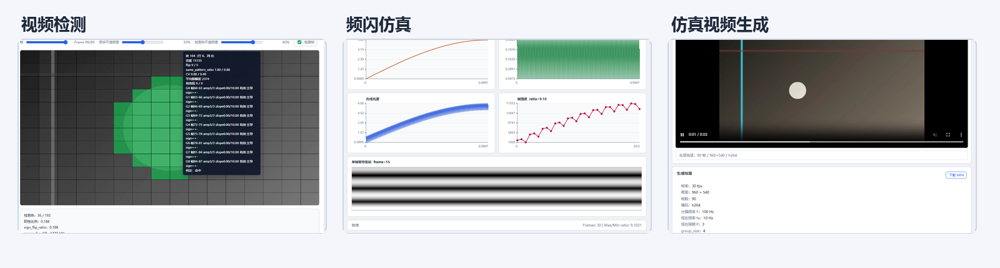
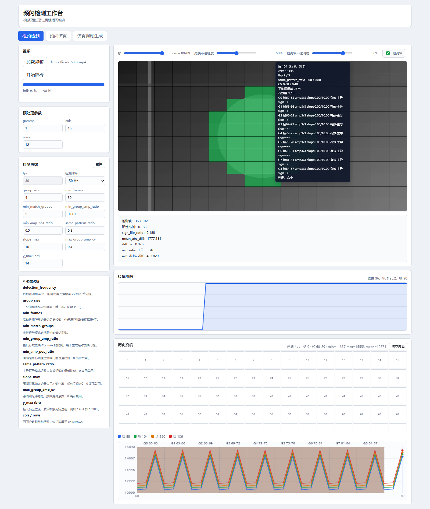
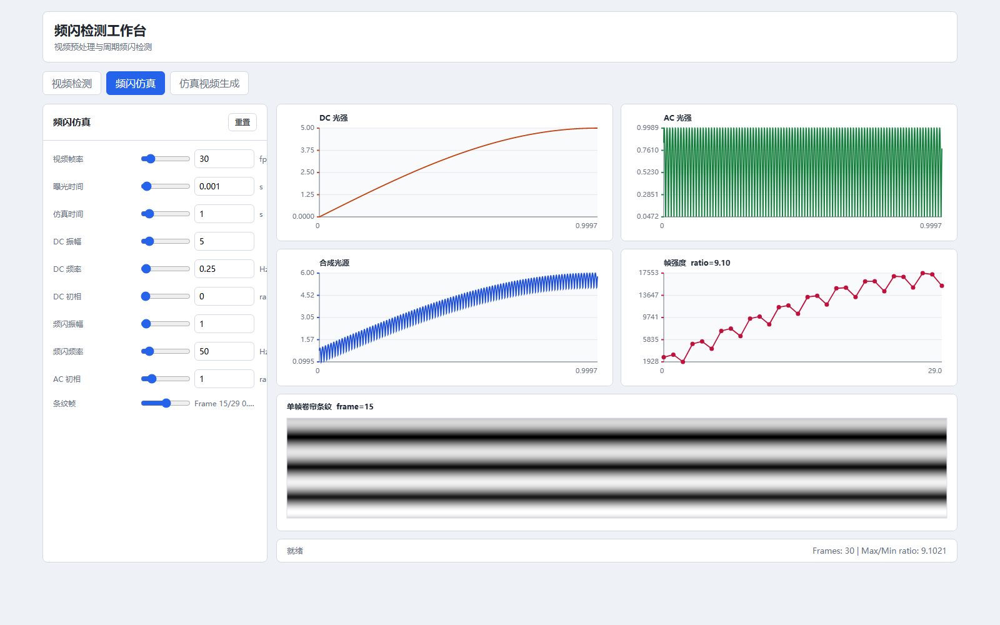
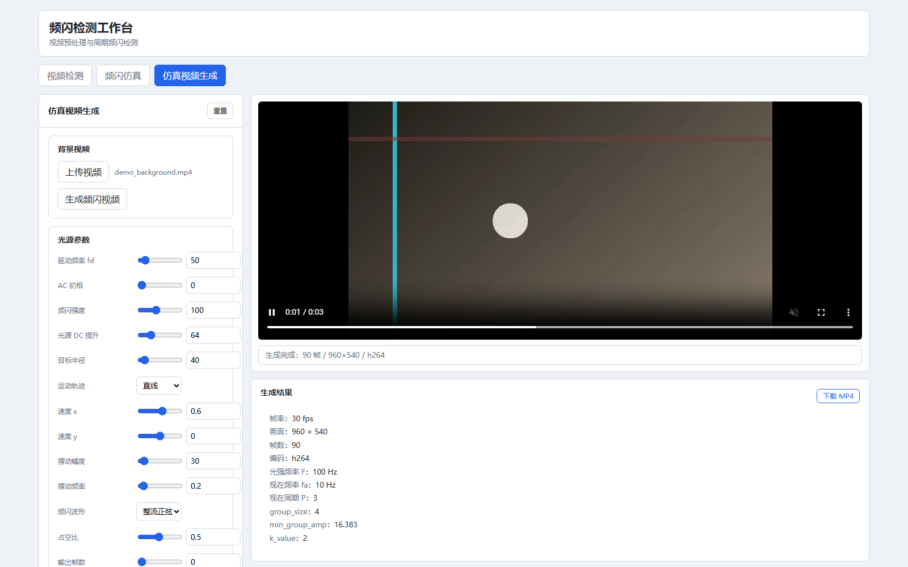
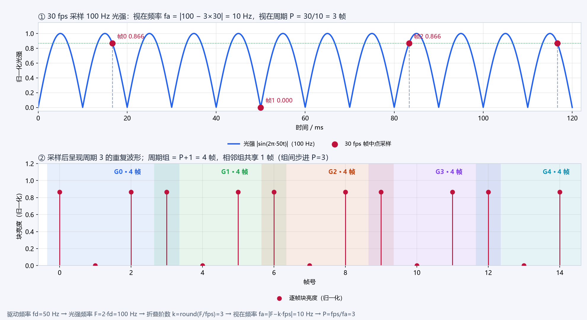
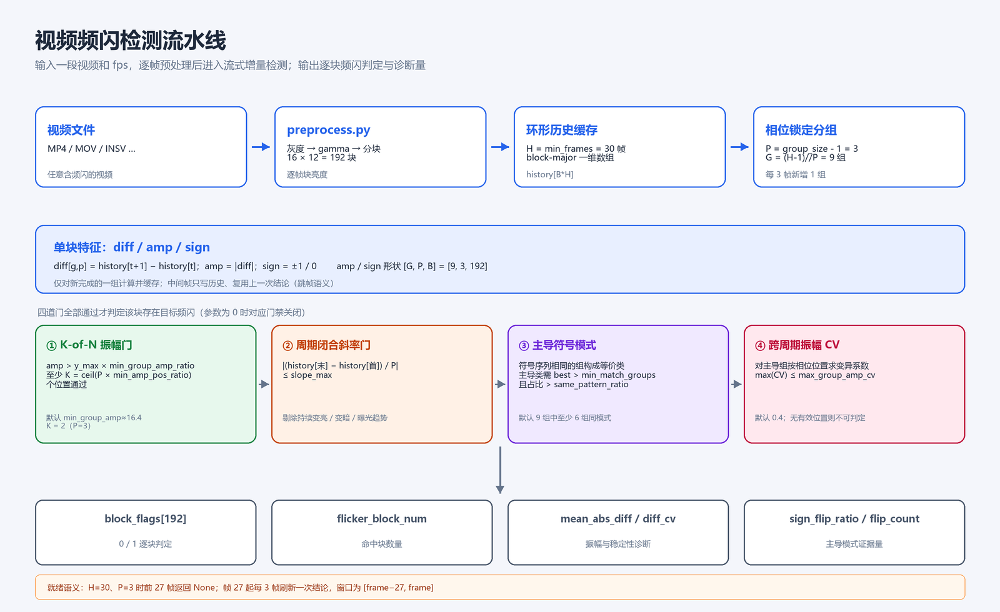
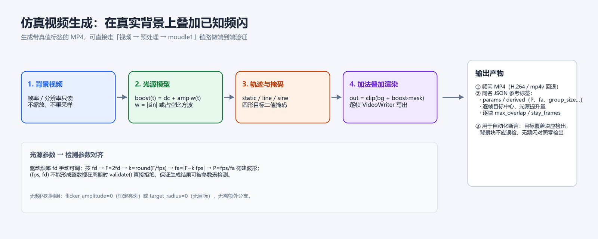
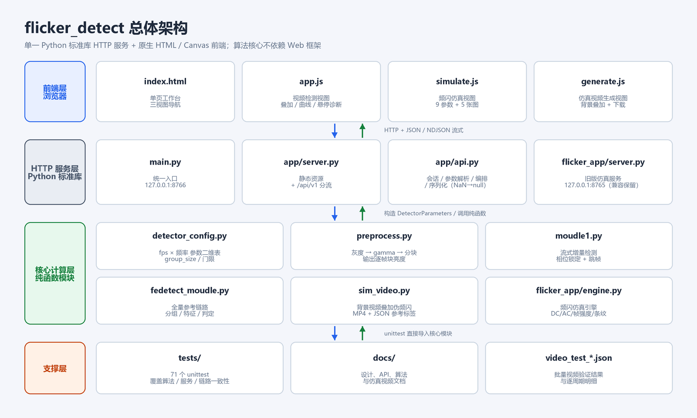

# flicker_detect

> 视频频闪检测与仿真工作台：从一段视频中逐块量化光源频闪，并提供频闪仿真、仿真视频生成两条辅助链路。

项目用**纯 Python 标准库 HTTP 服务 + 原生 HTML / Canvas 前端**实现，不依赖 Web 框架；核心检测算法是可直接翻译成嵌入式 C++ 的纯函数实现（显式循环、一维数组、固定 shape，不依赖 NumPy/OpenCV）。

- 输入：视频文件、fps、目标驱动频率（如 50 Hz 市电）
- 输出：逐块频闪判定 `block_flags`、命中块数、符号模式一致性、振幅稳定性等诊断量
- 辅助能力：频闪仿真曲线、卷帘快门条纹、在真实背景视频上叠加已知频闪并生成带真值标签的 MP4



## 目录

- [1. 项目定位](#1-项目定位)
- [2. 功能概览](#2-功能概览)
- [3. 快速开始](#3-快速开始)
- [4. 使用说明](#4-使用说明)
- [5. 工作原理](#5-工作原理)
- [6. 系统架构](#6-系统架构)
- [7. 测试与验证](#7-测试与验证)
- [8. 已知限制与后续计划](#8-已知限制与后续计划)
- [9. 项目文档](#9-项目文档)

## 1. 项目定位

频闪检测要回答的是：**画面中哪些区域的光源在按目标频率闪烁？**

项目按 `fps` 和目标驱动频率查表，把一个完整周期拆成 `P+1` 帧的重叠周期组，对每个画面分块分别判断其亮度时序是否呈现稳定的周期重复，最终输出 192 个块（16×12）的 0/1 判定和可解释的诊断量。算法只做“组有效性 + 模式一致性 + 振幅稳定性”的统计判定，不依赖条纹计数，也不测量未知频率。

当前正式支持的参数组合是 **30 fps** 下的 50 / 100 / 125 / 200 / 500 Hz（这些组合的视在周期都恰好为整数帧，`group_size = 4`）。

## 2. 功能概览

工作台是单页应用，顶部导航切换三个视图：

| 视图 | 入口 | 作用 |
| --- | --- | --- |
| 视频检测 | 默认视图 | 上传视频 → 预处理 → 流式检测 → 叠加/曲线/悬停诊断 |
| 频闪仿真 | 导航“频闪仿真” | 9 个参数驱动光源模型，绘制 DC/AC/合成光强/帧强度曲线与卷帘条纹 |
| 仿真视频生成 | 导航“仿真视频生成” | 在导入的真实背景视频上叠加已知频闪，输出 MP4 + 同名 JSON 真值标签 |

### 2.1 视频检测

1. 选择视频，设置 gamma 与分块网格，点击“开始解析”；
2. 后端逐帧灰度化、gamma 提亮、按 `cols × rows` 区域平均，通过 NDJSON 流式回传进度与块亮度；
3. 解析完成后自动按当前参数重算全部帧；修改检测参数会防抖自动重算，也可点“重算”手动触发；
4. 预览画布叠加显示块亮度热力图、检测块（绿色）和网格，悬停任意块可查看逐组诊断；
5. “检测块数”曲线展示每帧命中块数；
6. “历史亮度”面板可多选块，在同一张图中对比最近 `min_frames` 帧的亮度曲线，并标出周期组边界、有效组与主导组。



逐块悬停提示包含：亮度、`flip_count / min_match_groups`、`sign_flip_ratio`、`diff_cv`、平均振幅差、每个周期组的帧区间 / 振幅通过位置数 / 闭合斜率 / 有效与主导标记 / 符号序列，以及最终“命中 / 未命中”。

### 2.2 频闪仿真

- 9 个参数：视频帧率、曝光时间、仿真时间、DC 振幅/频率/初相、频闪振幅/频率、AC 初相；
- 滑块与数值输入双向同步，曝光时间上限自动跟随帧率（`1/fps`）；
- 参数变化后 200 ms 防抖自动重算，结果绘制 DC 光强、AC 光强、合成光源、帧强度四条曲线；
- 按 4K 2160 行模拟卷帘快门：单帧内每行曝光起始时间按 `y/2160 × 帧周期` 错开，形成帧内频闪条纹；可选择查看任意帧的条纹；
- 输出帧数、最大/最小帧强度比 `max_min_ratio`。



### 2.3 仿真视频生成

以导入的真实视频为**唯一背景**（fps、分辨率从背景读取，不可配置、不缩放），叠加一个圆形、强度可调的伪频闪光源：

- 光源可静止、匀速直线运动或正弦摆动；
- 波形支持整流正弦 `rectified_sin` 与占空比方波 `square`；
- 输出 MP4（优先 H.264，失败回退 mp4v / MJPG）与同名 JSON 参考标签；
- JSON 记录参数、`fd → F → fa → P` 派生量、逐帧目标中心/光源提升量、逐块最大重叠度与停留帧数，可直接用于自动化断言；
- 页内可预览生成视频、查看派生量并下载 MP4。



## 3. 快速开始

### 3.1 环境

- Python 3.12（开发环境为 conda 虚拟环境 `flicker`）
- `numpy==2.4.4`
- `opencv-python==4.13.0.92`
- 浏览器（Chrome / Edge 等现代浏览器）

### 3.2 安装

```powershell
conda activate flicker
pip install -r requirements.txt
```

### 3.3 启动

```powershell
python main.py
```

启动后访问 <http://127.0.0.1:8766>。可选参数：

```powershell
python main.py --host 127.0.0.1 --port 9000 --open-browser
```

- `--host`：监听地址，默认 `127.0.0.1`（仅本机访问）
- `--port`：端口，默认 `8766`
- `--open-browser`：启动后自动打开默认浏览器

### 3.4 其他驱动方式

项目除了 Web 工作台，还可以通过命令行和 HTTP API 驱动：

| 方式 | 命令 / 接口 | 说明 |
| --- | --- | --- |
| Web 工作台 | `python main.py` | 完整三视图，适合人工使用 |
| 频闪仿真 CLI | `python -m flicker_detect.moudle1` | 用 30fps/50Hz 合成信号演示纯逻辑检测 |
| 检测管线 CLI | `python -m flicker_detect.fedetect_moudle <video>` | 输出视频元数据、分组布局与特征矩阵形状 |
| 仿真视频 CLI | `python -m flicker_detect.sim_video --background-video bg.mp4 --output out.mp4` | 生成频闪 MP4 + JSON 参考标签 |
| HTTP API | `/api/v1/*` | 供任意前端或脚本接入，见 [6.2](#62-http-api) |
| 旧版仿真服务 | `flicker_app/server.py` | 127.0.0.1:8765，兼容保留 |

检测管线 CLI 示例：

```powershell
python -m flicker_detect.fedetect_moudle .\demo.mp4 `
  --fps 30 --frequency 50 --cols 16 --rows 12 --gamma 1.5 --max-frames 120
```

仿真视频 CLI 示例（帧率/分辨率从背景视频读取）：

```powershell
python -m flicker_detect.sim_video `
  --background-video .\bg.mp4 --output .\out.mp4 `
  --flicker-frequency 50 --flicker-amplitude 100 --flicker-dc 40 `
  --target-radius 80 --trajectory-type line --velocity-x 0.6 `
  --waveform rectified_sin --cols 16 --rows 12
```

## 4. 使用说明

### 4.1 视频检测步骤

1. **加载视频**：支持 OpenCV 可解码的常见格式（MP4 / MOV / AVI / INSV 等）；
2. **设置预处理参数**：`gamma`（<1 提亮）、`cols` / `rows`（默认 16×12，块数 = 192）；
3. **开始解析**：视频逐帧转换为 14 bit 块亮度并流式回传，进度条实时更新；
4. **自动检测**：解析完成即按当前参数运行检测；之后修改任一检测参数会 40 ms 防抖自动重算；
5. **查看结果**：
   - 帧滑块定位到任意帧；
   - 画布查看亮度热力图、绿色检测块、网格；
   - “检测块数”曲线看随帧变化；
   - 历史亮度面板多选块，查看曲线、周期组边界与有效/主导着色；
   - 悬停画布查看该块完整诊断。

> 检测结论在帧 `27` 之前不存在（历史窗口未就绪），对应位置显示为空/0。

### 4.2 检测参数

参数以 `flicker_detect/detector_config.py` 的 `PARAMETER_MATRIX` 为唯一事实来源，前端只做展示与覆盖，不复制参数表。

| 参数 | 30fps/50Hz 默认值 | 含义 |
| --- | --- | --- |
| `fps` | 30 | 视频帧率模式，来自视频元数据，只读 |
| `detection_frequency` | 50 | 目标驱动频率 `fd`（Hz），按 `F = 2fd` 折算光强频率 |
| `group_size` | 4 | 一个周期组包含的帧数，等于视在周期 `P + 1` |
| `min_frames` | 30 | 启动检测所需最少历史帧数，也是缓存与诊断窗口长度 |
| `min_match_groups` | 5 | 主导符号模式必须**超过**的最少组数 |
| `min_group_amp_ratio` | 0.001 | 最低有效振幅占 `y_max` 的比例（默认约 16.38/16383） |
| `min_amp_pos_ratio` | 0.5 | K-of-N 中每个周期组至少通过振幅门的位置比例 |
| `same_pattern_ratio` | 0.8 | 主导符号模式组数占有效组数的最低比例 |
| `slope_max` | 10.0 | 周期首尾允许的最大平均变化率（亮度/帧） |
| `max_group_amp_cv` | 0.4 | 跨周期振幅允许的最大变异系数 |
| `y_max_bit` | 14 | 输入亮度位深，满量程 `y_max = 2^bit − 1 = 16383` |
| `cols` / `rows` | 16 / 12 | 画面分块列数/行数，块总数 192 |

参数为 `0` 时对应门禁关闭：`min_amp_pos_ratio=0` 关闭 K-of-N、`slope_max=0` 关闭闭合斜率门、`min_match_groups=0` 与 `same_pattern_ratio=0` 关闭对应主导模式约束、`max_group_amp_cv=0` 关闭 CV 门。

### 4.3 检测结果字段

单帧检测结果（`/detect` 与单帧详情接口）包含：

| 字段 | 说明 |
| --- | --- |
| `block_flags` | 每个块的 0/1 频闪判定 |
| `flicker_block_num` | 命中块数量 |
| `flip_count` | 主导符号模式包含的周期组数 |
| `sign_flip_ratio` | 主导模式组数 / 有效组数 |
| `mean_abs_diff` | 主导组各有效位置的平均振幅 |
| `diff_cv` | 主导组各有效位置的最大振幅变异系数 |
| `avg_ratio_diff` | 窗口内块亮度最大值/最小值比的平均 |
| `avg_delta_diff` | 窗口内块亮度极差的平均 |
| `groups` | 每个周期组的起止帧 |
| `min_group_amp` / `k_value` | 当前换算后的振幅门槛与 K 值 |
| `group_valid` 等 | 仅单帧详情接口返回：逐组振幅通过数、斜率、有效/主导标记、符号序列 |

> 不可判定与“无频闪”在输出上都表现为 `block_flags = 0`；诊断字段中的 `NaN` 会在 JSON 中序列化为 `null`。

### 4.4 频闪仿真参数

| 参数 | 默认 | 含义 |
| --- | --- | --- |
| `video_frame_rate` | 30 | 视频帧率（fps） |
| `exposure_time` | 0.001 | 曝光时间（s），上限 `1/fps` |
| `simulation_time` | 1.0 | 仿真时长（s） |
| `dc_amplitude` | 5.0 | DC 光强振幅 |
| `dc_frequency` | 0.25 | DC 光强频率（Hz） |
| `dc_initial_phase` | 0.0 | DC 初相（rad） |
| `flicker_amplitude` | 1.0 | 频闪（AC）振幅 |
| `flicker_frequency` | 50.0 | 频闪频率（Hz），光强基频为 2× |
| `ac_initial_phase` | 1.0 | AC 初相（rad） |

仿真引擎按远高于帧率的采样率逼近连续光强，再在对每帧曝光窗口积分得到帧强度；卷帘条纹按 2160 行、行曝光窗口错开建模。

### 4.5 仿真视频生成参数

| 参数 | 默认 | 含义 |
| --- | --- | --- |
| `background_video` | 必填 | 背景视频，fps/分辨率/帧数均从它读取 |
| `flicker_frequency` | 50 | 驱动频率 `fd`（Hz），手动可调 |
| `flicker_phase` | 0.0 | AC 初相（rad） |
| `flicker_amplitude` | 100 | 频闪强度（8 bit 灰度幅值） |
| `flicker_dc` | 64 | 光源恒定提升量 |
| `target_radius` | 40 | 目标圆半径（px） |
| `trajectory_type` | line | `static` / `line` / `sine` |
| `start_x` / `start_y` | 画面中心偏左 | 轨迹起点 |
| `velocity_x` / `velocity_y` | 0.6 / 0.0 | 直线轨迹速度（px/帧） |
| `sine_amplitude` / `sine_frequency` | 30 / 0.2 | 正弦摆动幅度 / 频率 |
| `waveform` | rectified_sin | `rectified_sin` 或 `square` |
| `duty_cycle` | 0.5 | 方波占空比，仅 `square` 生效 |
| `frames` | 背景帧数 | 输出帧数上限 |
| `cols` / `rows` | 16 / 12 | 参考块网格，仅用于真值标签 |

光源提升量：

```text
w(t) = |sin(2π·fd·t + phase)|                  # rectified_sin
w(t) = 1 if frac(2·fd·t + phase/2π) < duty else 0  # square
boost(t) = flicker_dc + flicker_amplitude · w(t)
out(x, y, t) = clip(bg(x, y, t) + boost(t) · mask(x, y), 0, 255)
```

`flicker_amplitude=0` 或 `target_radius=0` 天然构成无频闪对照组。

## 5. 工作原理

### 5.1 频率定义与折叠

检测频率 `fd` 是光源驱动频率，实际光强频率 `F = 2·fd`。视频以 `fps` 逐帧采样后，高于 Nyquist 的频闪会折叠为视在频率 `fa`，视在周期 `P = fps / fa`（必须为整数帧才能用固定分组检测）。



| 量 | 公式 | 30fps / 50Hz |
| --- | --- | --- |
| 驱动频率 | `fd` | 50 Hz |
| 光强频率 | `F = 2·fd` | 100 Hz |
| 折叠阶数 | `k = round(F / fps)` | 3 |
| 视在频率 | `fa = |F − k·fps|` | 10 Hz |
| 视在周期 | `P = fps / fa` | 3 帧 |
| 周期组大小 | `group_size = P + 1` | 4 帧 |
| 同时活跃组数 | `G = (H − 1) // P` | 9 组（H=30） |
| K-of-N 的 K | `ceil(P × min_amp_pos_ratio)` | 2 |
| 振幅门槛 | `y_max × min_group_amp_ratio` | 16.383 |

`group_size_for(fps, fd)` 用分数精确计算 `fa` 与 `P`，只有 `P` 为整数时才返回 `group_size`；参数表中的 `group_size=0` 表示该组合未配置。

### 5.2 视频预处理

`flicker_detect/preprocess.py` 的职责是把视频变成检测算法需要的块亮度序列：

1. `cv2.VideoCapture` 读取视频元数据（fps、帧数、宽高）；
2. BGR 转灰度；
3. gamma 提亮：`output = y_max × (input / y_max) ^ gamma`（8 bit 输入用 256 项查找表加速）；
4. 按 `rows × cols` 用 `cv2.INTER_AREA` 做区域平均，按行优先展开成一维块数组；
5. 逐帧输出 `frame_id`、时间戳、块亮度 `[rows × cols]` 与亮度统计。

`frame_id` 从 0 递增；检测端用它做分组与相位锚定。默认输出 14 bit 满量程 16383。

### 5.3 流式增量检测

核心实现是 `flicker_detect/moudle1.py` 的 `detect_window_incremental(state, blocks, frame_id)`：**相位锁定 + 跳帧**。



- **状态**：`create_incremental_state(params)` 创建一个纯 dict 状态（等价 C++ 结构体），包含环形帧历史 `history[B×H]`、组振幅缓存、组符号编码缓存、阈值和上一份结论；
- **相位锚定**：首个 `frame_id` 记为 `phase_base`，第 k 组覆盖绝对帧 `[phase_base + k·P, phase_base + k·P + P]`；
- **每 P 帧新增一组**：只在 `rel >= P` 且 `rel % P == 0` 的帧完成一组特征计算，活跃组恒为 `G` 组；中间帧只写历史并复用上一次结论；
- **就绪**：累计 `G` 组后才出第一个结论（30fps/50Hz 下为帧 27），结论窗口为 `[frame − 27, frame]`；
- **单组特征**：闭合斜率门 → 相邻帧差分 → 振幅/符号编码 → K-of-N 振幅门；
- **块级判定**：计数扫描得到主导符号模式 → 与 `min_match_groups` / `same_pattern_ratio` 比较 → 对主导组计算按相位位置的振幅 CV → 四道门全部通过才置 `block_flags=1`。

四道判定门：

1. **K-of-N 振幅门**：`amp > y_max × min_group_amp_ratio` 的位置数 `>= K`；
2. **周期闭合斜率门**：`|(history[末] − history[首]) / P| <= slope_max`，剔除持续变亮/变暗/曝光趋势；
3. **主导符号模式**：符号序列（+ / 0 / −）完全相同的组构成等价类，主导类需 `best_size > min_match_groups` 且 `best_size / valid_count > same_pattern_ratio`；
4. **跨周期振幅 CV 门**：对主导组按相位位置求变异系数，`max(CV) <= max_group_amp_cv`。

> `flicker_detect/fedetect_moudle.py` 保留了一套“完整历史窗口一次判定”的 NumPy 参考实现（`group_frames` / `build_features` / `evaluate_group_validity` / `finalize_block_detection`），测试用它和流式实现做逐块一致性对照。

### 5.4 频闪仿真模型

`flicker_app/engine.py` 的 `FlickerEngine`：

- DC 与 AC 均用整流正弦建模：`dc = A_dc·|sin(2π f_dc t + φ)|`、`ac = A_ac·|sin(2π f_ac t + φ)|`，合成为总光强；
- 用 `fps × 1e5` 的采样率逼近连续光强，按每帧曝光窗口 `[frame/fps, frame/fps + exposure]` 积分得到帧强度；
- 曲线最多抽样 3000 个点用于前端绘制；
- 按 2160 行计算卷帘快门条纹：第 `y` 行曝光起点为 `frame/fps + y/2160 × 1/fps`，行内积分得到该行亮度；
- 输出 `max_min_ratio` 作为频闪幅度的快速指标。

### 5.5 仿真视频合成



`flicker_detect/sim_video.py` 按 `fd → F=2fd → k=round(F/fps) → fa=|F−k·fps| → P=fps/fa` 构建波形，在背景视频帧上做加法叠加。逐块真值不采用几何近似，而是把目标圆二值掩码用与预处理完全相同的 `INTER_AREA` 分块平均，得到每块重叠度；由此可精确重建“背景块亮度 + 重叠度 × 光源提升量”，供测试作 `np.allclose` 级断言。

## 6. 系统架构



### 6.1 目录结构

```text
flicker_detect/
├── main.py                       # 统一 Web 入口（默认 127.0.0.1:8766）
├── requirements.txt
├── app/                          # 统一 Web 工作台
│   ├── server.py                 # 静态资源 + /api/v1 分流 + 兼容 API
│   ├── api.py                    # API 层：会话、参数解析、编排、序列化
│   ├── index.html                # 单页工作台（三视图）
│   ├── app.js                    # 视频检测视图
│   ├── simulate.js               # 频闪仿真视图
│   ├── generate.js               # 仿真视频生成视图
│   └── style.css
├── flicker_app/                  # 频闪仿真引擎与旧版服务
│   ├── engine.py                 # DC/AC/帧强度/卷帘条纹计算
│   └── server.py                 # 旧版仿真 HTTP 服务（8765，兼容保留）
├── flicker_detect/               # 核心算法包
│   ├── detector_config.py        # fps × 频率参数二维表、group_size 推导
│   ├── preprocess.py             # 视频 → 灰度 → gamma → 分块
│   ├── moudle1.py                # 流式增量检测（生产实现）
│   ├── fedetect_moudle.py        # 全量参考实现（测试对照用）
│   └── sim_video.py              # 背景叠加伪频闪，生成 MP4 + JSON
├── tests/                        # 71 个 unittest
├── docs/                         # 设计、API、算法、验证文档
│   └── images/                   # README 配图
├── video_test_results.json       # 历史批量视频验证结果
└── video_test_cycles.json        # 历史逐周期明细
```

代码分层约束：

- **API 层**只做编排、状态和序列化，不包含检测算法；
- **算法层**只暴露纯函数，不感知 HTTP；
- **前端**只负责调度与展示，不内置算法。

### 6.2 HTTP API

| 方法 | 路径 | 说明 |
| --- | --- | --- |
| GET | `/api/v1/options?fps=30` | 返回该 fps 下所有可检测频率及完整参数 |
| POST | `/api/v1/sessions` | 创建会话，返回 `session_id` |
| POST | `/api/v1/sessions/{id}/video?name=&cols=&rows=&gamma=` | 请求体为视频原始字节；NDJSON 流式返回元数据与逐帧块亮度 |
| POST | `/api/v1/sessions/{id}/detect` | 请求体 `{fps, params}`，按参数重算全部帧 |
| GET | `/api/v1/sessions/{id}/frames/{frameId}?fps=&detection_frequency=...` | 返回该帧所在窗口的逐组诊断 |
| DELETE | `/api/v1/sessions/{id}` | 释放会话 |
| POST | `/api/v1/simulate` | 请求体为 9 个仿真参数的 JSON，返回曲线/帧强度/条纹 |
| POST | `/api/v1/generate?flicker_frequency=...` | 请求体为背景视频原始字节，生成频闪视频 |
| GET | `/api/v1/generated/{name}` | 下载已生成的视频或 JSON |

兼容接口（旧版页面脚本仍在使用）：

| 方法 | 路径 | 说明 |
| --- | --- | --- |
| GET | `/api/options?fps=30` | 等价于 v1 options |
| GET | `/api/detect?frame=&fps=&detection_frequency=...` | 单帧诊断 |
| GET | `/api/simulate?video_frame_rate=...` | 工作台仿真页实际调用的查询参数版仿真 |
| POST | `/api/convert?name=&cols=&rows=&gamma=` | 旧版转换流 |
| POST | `/api/recompute` | 旧版全量重算 |

上传视频的 NDJSON 流包含以下行类型：

- `meta`：fps、帧数、宽高、分块、`y_max`、`detector_params`、`detector_options`
- `progress`：`frame_id`、时间戳、百分比、块亮度、640 宽 JPEG 缩略图（base64）
- `done`：处理帧数
- `error`：转换失败信息

错误统一为：

```json
{ "error": { "code": "invalid_params", "message": "..." } }
```

错误码：`invalid_params`、`not_found`、`no_video`、`internal_error`。

示例：

```powershell
# 1. 创建会话
$sid = (Invoke-RestMethod -Method Post http://127.0.0.1:8766/api/v1/sessions).session_id

# 2. 上传并转换（NDJSON 流）
curl.exe -X POST "http://127.0.0.1:8766/api/v1/sessions/$sid/video?name=demo.mp4&cols=16&rows=12&gamma=1.0" `
  --data-binary "@demo.mp4"

# 3. 重算检测
curl.exe -X POST "http://127.0.0.1:8766/api/v1/sessions/$sid/detect" `
  -H "Content-Type: application/json" `
  -d '{"fps":30,"params":{"detection_frequency":50}}'
```

### 6.3 运行时数据

- 会话数据只保存在服务端内存：`session_id → {meta, blocks}`，`blocks[frame][block]`；服务重启即失效；
- 单会话内存约 `block_count × 帧数` 个浮点数（192 块 × 帧数）；
- 生成的仿真视频与 JSON 写入系统临时目录 `flicker_generated/`，服务重启后不可再下载；
- 默认只监听 `127.0.0.1`，无鉴权，适合本机使用。

## 7. 测试与验证

### 7.1 运行测试

测试使用标准库 `unittest`，不依赖 pytest：

```powershell
conda activate flicker
python -m unittest discover -s tests -v
```

当前共 **71 个用例**，覆盖：

| 测试文件 | 覆盖内容 |
| --- | --- |
| `test_detector_config.py` | 参数表、`group_size_for`、位深换算、块数 |
| `test_preprocess.py` | 视频元数据、gamma 提亮、非整除分块 |
| `test_fedetect_moudle.py` | 分组布局、特征矩阵、四道门、最终判定 |
| `test_moudle1.py` | 流式增量与全量实现逐块一致、就绪/跳帧/重置语义 |
| `test_app_server.py` / `test_api.py` | 页面、会话生命周期、上传、重算、单帧详情、NaN 序列化 |
| `test_engine.py` / `test_server.py` | 仿真引擎与旧版服务 |
| `test_sim_30fps_consistency.py` | 用仿真引擎生成已知频闪数据，核对两种实现与真值 |

`test_sim_30fps_consistency.py` 覆盖 30fps 下 50/100/125/200/500 Hz 全部有效驱动频率，断言“有频闪全部块检出、无频闪零检出”，并要求流式实现与全量参考实现逐块一致。

### 7.2 历史批量验证

`docs/video_test_summary.md` 记录了一次对 35 个真实视频（含 4K MP4 与 INSV）的批量验证：30 个视频有可用参数并完成检测，总耗时约 427 s；结果明细在 `video_test_results.json` 与 `video_test_cycles.json`。该批次输出的是组有效性阶段的 `dominant_ok` 统计，用于观察参数在真实素材上的表现，不等同于最终 `block_flags` 结论。

## 8. 已知限制与后续计划

- **正式支持的 fps 有限**：参数表目前只为 30 fps 的 50/100/125/200/500 Hz 填写 `group_size`；其他 fps 组合的 `group_size` 为 0，不保证可用。前端下拉会按 `group_size_for()` 展示所有能形成整数视在周期的组合，其他组合属实验性支持。
- **移动目标存在检出回归**：当前流式实现采用单相位 + 跳帧，只对恰好落在相位边界上的突发敏感；移动/瞬变目标可能被“劈”进相邻组而漏检。详见 `docs/moudle1_moving_target_design.md`，建议方案（P 相位旋转 / 轨迹采样）尚未实施。
- **8 bit 视频的平台位置符号抖动**：符号“不变”的判定阈值 `SIGN_ZERO_EPSILON = 1e-4` 是 14 bit 空间内的绝对容差；8 bit 视频经 ×64.25 映射后，平台位置可能出现 ±1 个量化级别的抖动，从而把 `0` 翻成 `+`/`−`，削弱主导模式一致性。实测中会降低检出率，建议使用更高位深素材、避开波形平台位置或调整阈值。
- **位深参数只影响检测阈值**：`y_max_bit` 用于换算检测端满量程；预处理固定输出 14 bit（`DEFAULT_Y_MAX=16383`），修改 `y_max_bit` 不会改变预处理缩放。
- **无持久化与鉴权**：会话和生成文件只存在于内存/临时目录；服务默认仅本机可访问，不适合直接暴露到公网。
- **算法逐块独立**：不使用相邻块的空间连续性，因此不会判断命中块是否构成真实频闪区域，也缺少置信度模型。
- **参数组合校验不完整**：错误配置可能导致静默零检出或判定条件退化，调整阈值时需结合诊断量检查。

## 9. 项目文档

| 文档 | 内容 |
| --- | --- |
| `docs/PLAN.md` | 项目目标、频率定义、检测流程、参数关系与约束、推进计划 |
| `docs/api_design.md` | API 分层、接口清单、请求/响应示例、错误码 |
| `docs/pure_logic_detector_design.md` | 纯逻辑单函数版算法设计（可直接映射 C++） |
| `docs/moudle1_moving_target_design.md` | 移动目标频闪检测现状、回归分析与后续路线 |
| `docs/sim_video_generation_design.md` | 仿真视频生成的参数、渲染模型、真值与测试设计 |
| `docs/video_test_summary.md` | 真实视频批量验证结果 |

## 10. License

见 `LICENSE`（MIT）。
